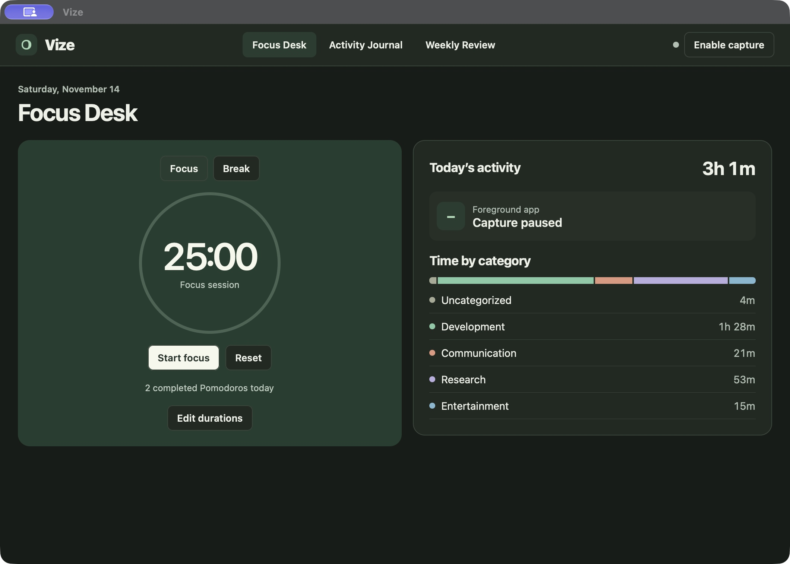
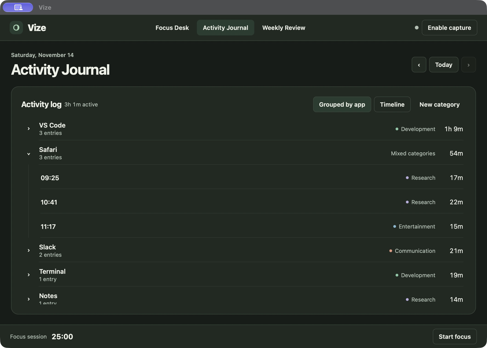
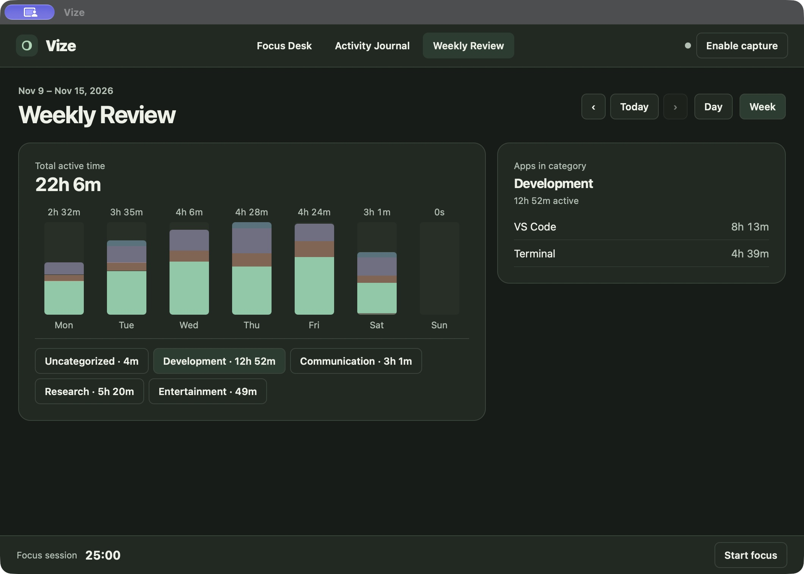

# Vize

Vize is a Mac time tracker with a Pomodoro timer and local reports. **Focus Desk** shows the timer and today’s category totals. **Activity Journal** edits captured blocks and saves app defaults. **Weekly Review** shows day and week totals with a category-to-app breakdown.

Enable capture in the window or menu bar to begin. Vize stores foreground application names, bundle identifiers, and timestamps. It ends a block after five minutes without input. Closing the window keeps capture and the timer running. Use the menu-bar item to reopen Vize or quit. Quitting pauses an unfinished timer and preserves its remaining time.

Vize runs offline and stores its database in Application Support. The database is at `~/Library/Application Support/Vize/activity.sqlite3`.

Use the **Guest** menu in the sidebar to sign in or create an account. Tracking and reports are available in guest mode. Activity stays on this Mac in either mode. Vize keeps the session token in macOS Keychain.

## Screenshots

### Focus Desk



### Activity Journal



### Weekly Review



## Build on macOS

Use macOS 14 or later, Xcode 26.6 (verified toolchain), Node 22.18.0, npm, and CocoaPods 1.17.0. The first dependency installation requires network access.

```sh
nvm use
npm ci
pod install --project-directory=macos
npm run build:release
open build/macos/Build/Products/Release/Vize.app
```

The Release build bundles its JavaScript and uses local ad-hoc signing. For development, run `npm start` and use the `vize-macOS` scheme in `macos/vize.xcworkspace`.

For local account testing, start the separate `vize-backend` development server on `127.0.0.1:8000`. To build against a hosted backend, run `VIZE_API_BASE_URL=https://your-api-host.example npm run build:release`. Sign-in and sign-out require the account server.

```sh
npm run typecheck
npm test -- --runInBand
npm run test:native
```
